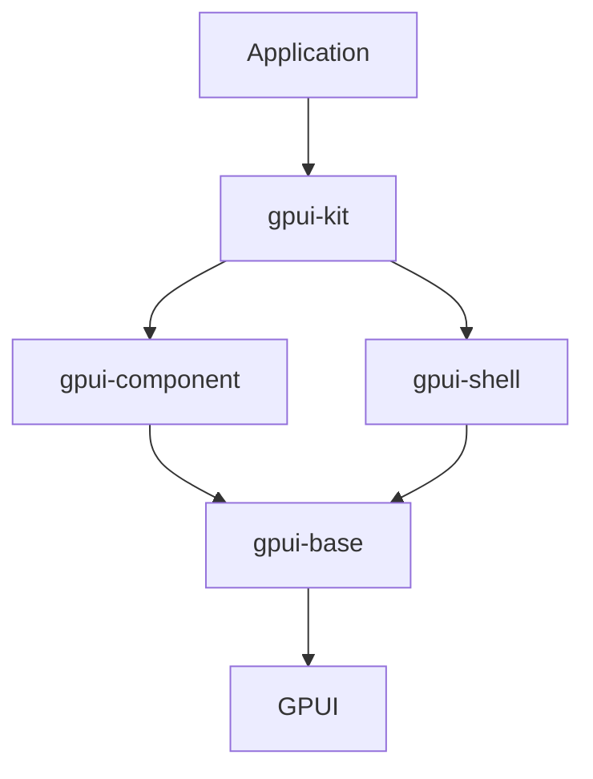

# longbridge/gpui-component

> Framework Rust d'applications de bureau sur GPUI, avec plus de 75 composants, pour développeurs d'apps natives.

## Le problème
Construire une interface de bureau performante en Rust sans réécrire tables, éditeur, docks.

## Ce que ça fait vraiment
`gpui-kit` regroupe `gpui-base` (comportement non stylé), `gpui-component` (composants stylés : tables virtuelles, éditeur de code, dock, Markdown/HTML, graphiques) et `gpui-shell` (extensions JavaScript). Support WebAssembly, AccessKit, tests d'intégration headless. Issu de l'application commerciale Longbridge Pro. Le README décrit aussi des skills pour agents de code.

## Comment c'est branché


## Essayer
```bash
# Cargo.toml : gpui-kit = "0.7"
cargo run
cargo run -p example-dock
npx skills add longbridge/gpui-kit
```

## Coût et pièges
Gratuit. Une licence est présente mais GitHub ne l'identifie pas : à lire avant usage commercial.

## Ce que ce n'est pas
Pas un framework web ni Python. Cible desktop Rust.

## Alternatives
Iced, egui et Qt 6 (comparaison citée sur le site).

## Pour toi
Surveiller : pertinent seulement pour un outil desktop Rust ; vérifier la licence d'abord.

