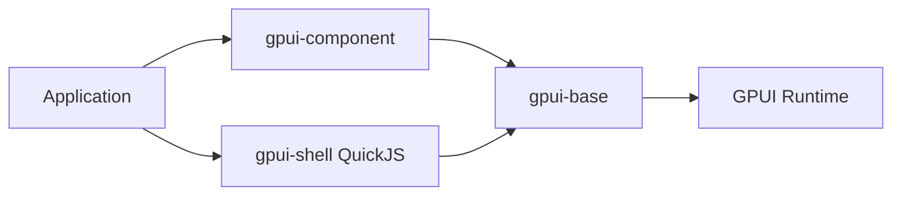

# longbridge/gpui-kit

> Rust desktop UI framework on GPUI: 75+ components, editor, tables and JavaScript extensions.

## The problem
Building a native Rust desktop application requires components, a theme system and data building blocks that GPUI alone does not provide.

## What it actually does
Three layers: `gpui-base` (unstyled behavior), `gpui-component` (styled components: virtual tables, Tree-sitter/LSP code editor, dock layout, Markdown/HTML, charts) and `gpui-shell` (QuickJS host for JavaScript extensions with capabilities granted one by one). WebAssembly, AccessKit accessibility, headless integration tests.

## How it is wired


## Trying it
```toml
gpui-kit = "0.7"
```
```bash
cargo run
cargo run -p example-dock
npx skills add longbridge/gpui-kit
```

## Cost and gotchas
Free. A license is present but not identified by GitHub: read it before use. Version 0.x. Depends on a pinned GPUI snapshot.

## What it is not
Not a data visualization tool: a UI kit. The advertised performance figures (120 FPS, 200K rows) are the README's own.

## Alternatives
Iced, egui and Qt 6 (comparison deferred to the website).

## For you
Little interest outside Rust desktop application development: ignore.
