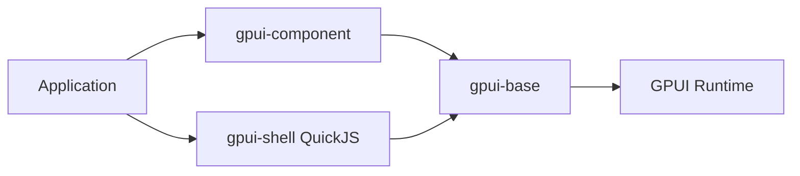

# longbridge/gpui-kit

> Framework Rust d'interfaces de bureau sur GPUI : 75+ composants, éditeur, tables et extensions JavaScript.

## Le problème
Construire une application de bureau Rust native demande des composants, un système de thème et des briques de données que GPUI seul ne fournit pas.

## Ce que ça fait vraiment
Trois couches : `gpui-base` (comportement non stylé), `gpui-component` (composants stylés : tables virtuelles, éditeur de code Tree-sitter/LSP, disposition dock, Markdown/HTML, graphiques) et `gpui-shell` (hôte QuickJS pour extensions JavaScript avec capacités accordées une à une). WebAssembly, accessibilité AccessKit, tests d'intégration headless.

## Comment c'est branché


## Essayer
```toml
gpui-kit = "0.7"
```
```bash
cargo run
cargo run -p example-dock
npx skills add longbridge/gpui-kit
```

## Coût et pièges
Gratuit. Licence présente mais non identifiée par GitHub : à lire avant usage. Version 0.x. Dépend d'un instantané GPUI épinglé.

## Ce que ce n'est pas
Pas un outil de visualisation de données : un kit d'UI. Les performances annoncées (120 FPS, 200K lignes) sont celles du README.

## Alternatives
Iced, egui et Qt 6 (comparaison renvoyée au site).

## Pour toi
Peu d'intérêt hors développement d'applications Rust de bureau : à ignorer.

