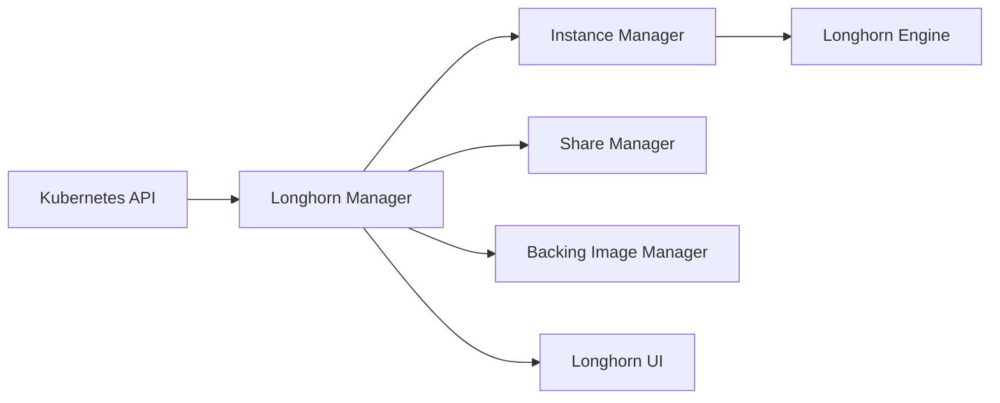

# longhorn/longhorn

> Distributed block storage for Kubernetes, with snapshots and backups, for teams that manage their own clusters.

## The problem
Kubernetes pods need replicated persistent volumes, without buying a SAN array or operating Ceph.

## What it actually does
A dedicated controller per volume replicates synchronously across several nodes. Incremental snapshots, backups to NFSv4 or S3, non-disruptive upgrades, web dashboard, RWX volumes via an NFS share manager. V1 (iSCSI) and V2 (SPDK) engines.

## How it is wired

## Trying it
The README announces three routes, without detailed commands: Rancher App Marketplace, kubectl, Helm. Commands: not documented in this README.

## Cost and gotchas
Free, but requires an existing Kubernetes cluster. 1,922 open issues. Backup targets (S3/NFS) at your own expense.

## What it is not
Not object storage nor a general-purpose shared file system. The master branch is meant for development, not for installation.

## Alternatives
No alternative named in the README.

## For you
Watch if you operate a K8s cluster for MLOps with persistent volumes; useless outside Kubernetes.
