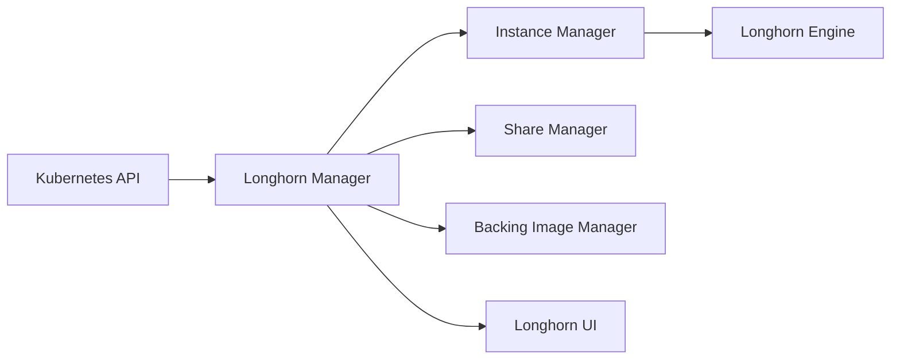

# longhorn/longhorn

> Stockage bloc distribué pour Kubernetes, avec snapshots et sauvegardes, pour les équipes qui gèrent leurs clusters.

## Le problème
Les pods Kubernetes ont besoin de volumes persistants répliqués, sans acheter une baie SAN ni opérer Ceph.

## Ce que ça fait vraiment
Un contrôleur dédié par volume réplique de façon synchrone sur plusieurs nœuds. Snapshots incrémentaux, sauvegardes vers NFSv4 ou S3, mises à jour sans interruption, dashboard web, volumes RWX via un NFS share manager. Moteurs V1 (iSCSI) et V2 (SPDK).

## Comment c'est branché

## Essayer
Le README annonce trois voies, sans commande détaillée : Rancher App Marketplace, kubectl, Helm. Commandes : non documentées dans ce README.

## Coût et pièges
Gratuit, mais exige un cluster Kubernetes existant. 1 922 issues ouvertes. Cibles de sauvegarde (S3/NFS) à ta charge.

## Ce que ce n'est pas
Pas un stockage objet ni un système de fichiers partagé généraliste. La branche master est destinée au développement, pas à l'installation.

## Alternatives
Aucune alternative nommée dans le README.

## Pour toi
À surveiller si tu opères un cluster K8s pour du MLOps avec volumes persistants ; inutile hors Kubernetes.

