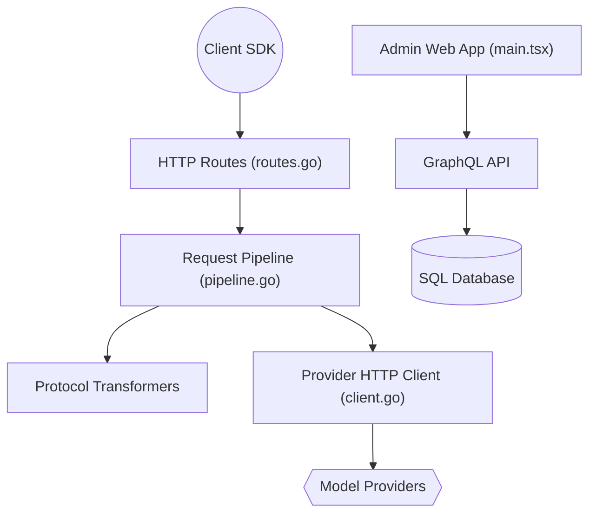

# looplj/axonhub

> Self-hosted AI gateway that translates calls from any SDK to any model provider.

## The problem
Switching LLM providers forces you to change SDKs and code, and tracking of costs and requests is scattered.

## What it actually does
AxonHub receives requests in OpenAI, Anthropic or Gemini formats, converts them to the configured provider through a pipeline of transformers, and routes between channels with retry and failover. A web console manages channels, models, API keys, RBAC, quotas, traces, cost analytics and storage. It covers text, image, rerank and embeddings; real-time is still to be done.

## How it is wired


## Trying it
```python
from openai import OpenAI

client = OpenAI(
    base_url="http://localhost:8090/v1",
    api_key="your-axonhub-api-key"
)
response = client.chat.completions.create(
    model="gpt-4o",
    messages=[{"role": "user", "content": "Hello, AxonHub!"}]
)
```
Deployment has no command in the README: it asks an agent to follow the `deploy-axonhub` guide.

## Cost and gotchas
Free, but the providers' API keys and their bills remain at your expense. The README is in Chinese and contains API reseller banners; the public demo account is shared, do not use it for your data.

## What it is not
Not a model provider and not a way to get models for free. The announced failover times (under 100 ms) are claims made by the README.

## Alternatives
No alternative cited in the README.

## For you
Worth watching: useful if you juggle between providers and want centralized cost tracking, but the lack of a documented deployment command and a very commercial README call for testing before committing.
