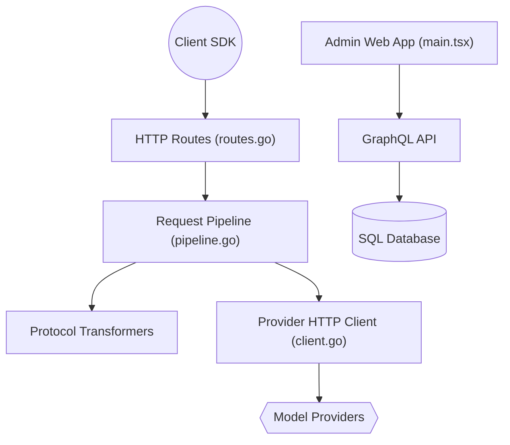

# looplj/axonhub

> Passerelle d'IA auto-hébergée qui traduit les appels de n'importe quel SDK vers n'importe quel fournisseur de modèles.

## Le problème
Changer de fournisseur de LLM oblige à changer de SDK et de code, et le suivi des coûts et des requêtes est dispersé.

## Ce que ça fait vraiment
AxonHub reçoit des requêtes aux formats OpenAI, Anthropic ou Gemini, les convertit vers le fournisseur configuré via un pipeline de transformateurs, et route entre canaux avec reprise et bascule. Une console web gère canaux, modèles, clés d'API, RBAC, quotas, traces, analytique de coûts et stockage. Il couvre texte, image, rerank et embeddings ; le temps réel reste à faire.

## Comment c'est branché


## Essayer
```python
from openai import OpenAI

client = OpenAI(
    base_url="http://localhost:8090/v1",
    api_key="your-axonhub-api-key"
)
response = client.chat.completions.create(
    model="gpt-4o",
    messages=[{"role": "user", "content": "Hello, AxonHub!"}]
)
```
Le déploiement n'a pas de commande dans le README : il demande à un agent de suivre le guide `deploy-axonhub`.

## Coût et pièges
Gratuit, mais les clés d'API des fournisseurs et leur facture restent à ta charge. Le README est en chinois et contient des encarts de revendeurs d'API ; le compte de démo public est partagé, ne l'utilise pas pour tes données.

## Ce que ce n'est pas
Pas un fournisseur de modèles et pas un moyen de les obtenir gratuitement. Les temps de bascule annoncés (moins de 100 ms) sont des affirmations du README.

## Alternatives
Aucune alternative citée dans le README.

## Pour toi
À surveiller : utile si tu jongles entre fournisseurs et veux un suivi centralisé des coûts, mais l'absence de commande de déploiement documentée et un README très commercial invitent à tester avant de s'engager.

