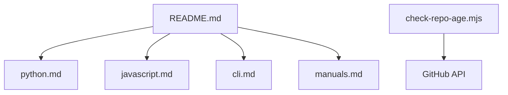

# lorien/awesome-web-scraping

> List of web scraping packages, services and manuals, sorted by language.

## The problem
Finding the right scraping tools among a scattered offering, depending on the language used.

## What it actually does
A README that serves as an index to per-language lists (Python, PHP, Ruby, JavaScript, Go, Java), command-line tools and manuals. It also mentions headless browsers, DNS over HTTPS, pastebins and tunneling. Node scripts check the age of the proposed repos and AI-related content in pull requests.

## How it is wired

## Trying it
No command documented in the README: browse the lists.

## Cost and gotchas
Free. The README cites captcha services and proxy marketplaces, some of which are paid and of dubious reputation (proxy-selling forums).

## What it is not
Not a scraping tool: a directory. No quality assessment of the entries. License present but not identified by GitHub.

## Alternatives
No alternative named in the README.

## For you
Worth watching as a starting point for data collection, to consult as needed rather than follow continuously.
