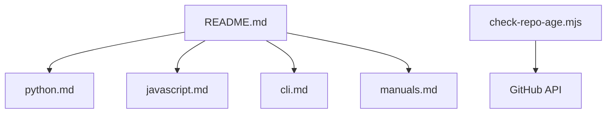

# lorien/awesome-web-scraping

> Liste de paquets, services et manuels de web scraping, classés par langage.

## Le problème
Trouver les bons outils de scraping parmi une offre éparse selon le langage utilisé.

## Ce que ça fait vraiment
README qui sert d'index vers des listes par langage (Python, PHP, Ruby, JavaScript, Go, Java), outils en ligne de commande et manuels. Il mentionne aussi navigateurs headless, DNS over HTTPS, pastebins et tunneling. Des scripts Node vérifient l'âge des dépôts proposés et le contenu lié à l'IA dans les pull requests.

## Comment c'est branché

## Essayer
Aucune commande documentée dans le README : parcourir les listes.

## Coût et pièges
Gratuit. Le README cite des services de captcha et des marchés de proxys, dont certains sont payants et de réputation douteuse (forums de vente de proxys).

## Ce que ce n'est pas
Pas un outil de scraping : un annuaire. Aucune évaluation de qualité des entrées. Licence présente mais non identifiée par GitHub.

## Alternatives
Aucune alternative nommée dans le README.

## Pour toi
À surveiller comme point de départ pour la collecte de données, à consulter au besoin plutôt qu'à suivre en continu.

