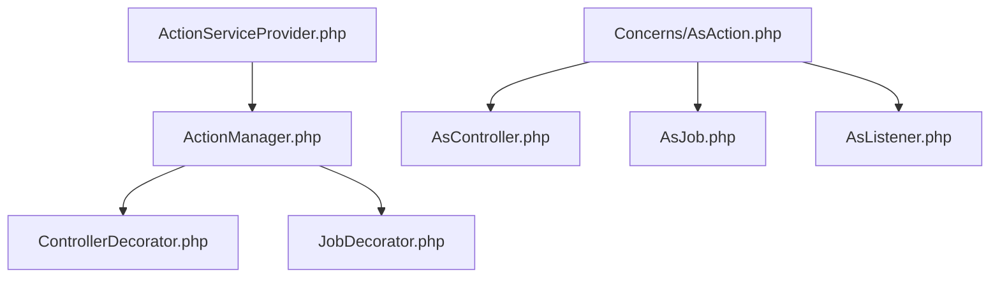

# lorisleiva/laravel-actions

> Laravel package for writing one class per task and running it as a controller, job, listener or command.

## The problem
Business logic gets scattered across controllers, jobs and listeners that all do the same thing.

## What it actually does
The `AsAction` trait lets a class be called as an object, controller, job, listener or artisan command by defining `handle` and the methods `asController`, `asJob`, `asListener`, `asCommand`. `ActionManager` wraps the action in the appropriate decorator. Also lets you mock actions in tests.

## How it is wired
Diagram based on the code diagram.



## Trying it
```bash
composer require lorisleiva/laravel-actions
php artisan make:action PublishANewArticle
```

## Cost and gotchas
Free, but PHP, Composer and a Laravel project are required (outside the prerequisites list). Imposes an architecture convention on the whole team.

## What it is not
Not a standalone framework: it only works within Laravel.

## Alternatives
No alternative named in the README.

## For you
Ignore: Laravel-specific, unrelated to data/AI/MLOps.
