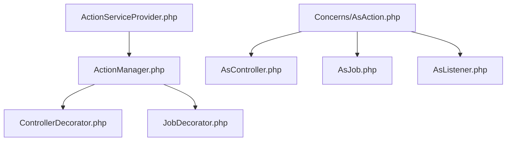

# lorisleiva/laravel-actions

> Paquet Laravel pour écrire une classe par tâche et l'exécuter comme contrôleur, job, listener ou commande.

## Le problème
La logique métier se disperse entre contrôleurs, jobs et listeners qui font tous la même chose.

## Ce que ça fait vraiment
Le trait `AsAction` permet à une classe d'être appelée comme objet, contrôleur, job, listener ou commande artisan en définissant `handle` et des méthodes `asController`, `asJob`, `asListener`, `asCommand`. `ActionManager` enveloppe l'action dans le décorateur adapté. Permet aussi de mocker les actions en tests.

## Comment c'est branché
Schéma d'après le diagramme du code.



## Essayer
```bash
composer require lorisleiva/laravel-actions
php artisan make:action PublishANewArticle
```

## Coût et pièges
Gratuit, mais PHP, Composer et un projet Laravel sont nécessaires (hors liste des prérequis). Impose une convention d'architecture à toute l'équipe.

## Ce que ce n'est pas
Pas un framework autonome : il ne fonctionne qu'au sein de Laravel.

## Alternatives
Aucune alternative nommée dans le README.

## Pour toi
À ignorer : spécifique à Laravel, sans lien avec data/IA/MLOps.

