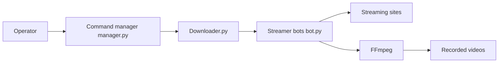

# lossless1024/StreaMonitor

> Python application that monitors and records live streams, mostly adult, across several sites.

## The problem
Automatically recording a live stream as soon as the broadcaster connects requires continuously polling several sites.

## What it actually does
Per-site adapters check whether each broadcaster is online, then downloaders record the stream with FFmpeg. It is driven from the console, through a remote controller via ZeroMQ ("sort of working" according to the README) or through a web interface on port 5000. Configuration is in `parameters.py` and the StripChat decryption keys must be supplied yourself.

## How it is wired


## Trying it
```
python3 Downloader.py
python3 Controller.py add <username> <website>
python3 Controller.py status
```

## Cost and gotchas
Free. Requires Python 3, FFmpeg and the dependencies in `requirements.txt`. Default web password is admin/admin, or empty if not set. The project is only a proof of concept.

## What it is not
The README admits it: most broadcasters prohibit recording, and sharing or monetizing may be punishable by law. It is not a neutral tool.

## Alternatives
Recordurbate (which the project draws inspiration from, according to the README).

## For you
Ignore: it records adult content in defiance of broadcasters' prohibition, a legal risk unrelated to your work.
