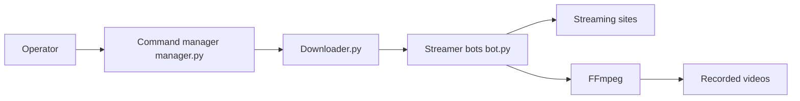

# lossless1024/StreaMonitor

> Application Python qui surveille et enregistre des flux en direct, surtout pour adultes, sur plusieurs sites.

## Le problème
Enregistrer automatiquement un direct dès que le diffuseur se connecte demande de scruter plusieurs sites en continu.

## Ce que ça fait vraiment
Des adaptateurs par site vérifient si chaque diffuseur est en ligne, puis des téléchargeurs enregistrent le flux avec FFmpeg. Le pilotage se fait par console, par un contrôleur à distance via ZeroMQ (« sort of working » selon le README) ou par une interface web sur le port 5000. La configuration est dans `parameters.py` et les clés de déchiffrement StripChat sont à fournir soi-même.

## Comment c'est branché


## Essayer
```
python3 Downloader.py
python3 Controller.py add <username> <website>
python3 Controller.py status
```

## Coût et pièges
Gratuit. Il faut Python 3, FFmpeg et les dépendances de `requirements.txt`. Mot de passe web par défaut admin/admin ou vide si non réglé. Le projet n'est qu'une preuve de concept.

## Ce que ce n'est pas
Le README l'avoue : la plupart des diffuseurs interdisent l'enregistrement, et le partage ou la monétisation peut être puni par la loi. Ce n'est pas un outil neutre.

## Alternatives
Recordurbate (dont le projet s'inspire, d'après le README).

## Pour toi
Ignorer : enregistre du contenu pour adultes en contournant l'interdiction des diffuseurs, un risque juridique sans rapport avec ton métier.

