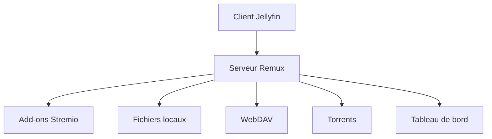

# lostb1t/remux

> Jellyfin-compatible media server that brings together Stremio add-ons, local files, WebDAV and torrents.

## The problem
Bringing Stremio, local, WebDAV and torrent sources together in a single catalogue that Jellyfin clients can browse is not natively possible.

## What it actually does
A server written in Rust: Jellyfin clients (Infuse, Swiftfin, Android) work unchanged. Built-in torrent streaming, an independent music pipeline, dynamic library filtering, import of Jellyfin users, dashboard, IPTV, desktop application.

## How it is wired
Simplified diagram based on the sheet, no diagram provided.



## Trying it
```yml
services:
  remux:
    image: ghcr.io/lostb1t/remux:latest
    ports:
      - "3000:3000"
    volumes:
      - /remux/data:/data
```

## Cost and gotchas
Free, AGPL-3.0 licence. Logs have no size cap and can fill the disk. Torrent streaming may raise rights questions depending on the content.

## What it is not
Not a data or AI tool. Not a content provider: it aggregates sources that you bring.

## Alternatives
- Jellyfin: the server whose API it reuses.

## For you
Ignore: a media server unrelated to a data / AI / MLOps profile.
