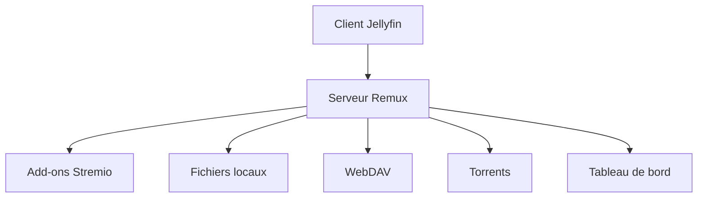

# lostb1t/remux

> Serveur multimédia compatible Jellyfin qui réunit add-ons Stremio, fichiers locaux, WebDAV et torrents.

## Le problème
Regrouper dans un seul catalogue consultable avec les clients Jellyfin des sources Stremio, locales, WebDAV et torrent n'est pas possible nativement.

## Ce que ça fait vraiment
Serveur en Rust : les clients Jellyfin (Infuse, Swiftfin, Android) fonctionnent sans changement. Streaming de torrents intégré, pipeline musique indépendant, filtrage dynamique des bibliothèques, import des utilisateurs Jellyfin, tableau de bord, IPTV, application de bureau.

## Comment c'est branché
Schéma simplifié d'après la fiche, sans diagramme fourni.



## Essayer
```yml
services:
  remux:
    image: ghcr.io/lostb1t/remux:latest
    ports:
      - "3000:3000"
    volumes:
      - /remux/data:/data
```

## Coût et pièges
Gratuit, licence AGPL-3.0. Les journaux n'ont pas de plafond de taille et peuvent remplir le disque. Le streaming de torrents peut poser des questions de droits selon les contenus.

## Ce que ce n'est pas
Pas un outil de data ou d'IA. Pas un fournisseur de contenus : il agrège des sources que tu apportes.

## Alternatives
- Jellyfin : le serveur dont il reprend l'API.

## Pour toi
Ignorer : serveur multimédia sans rapport avec un profil data / IA / MLOps.

