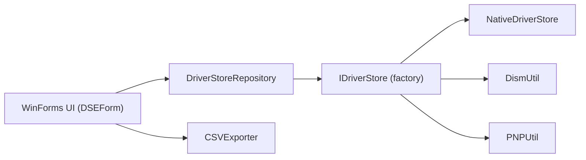

# lostindark/DriverStoreExplorer

> Utilitaire Windows pour lister, sauvegarder et supprimer les pilotes du DriverStore.

## Le problème
Le dossier des pilotes Windows grossit avec les anciennes versions, et les gérer à la main est risqué.

## Ce que ça fait vraiment
Application WinForms (.NET Framework 4.7.2+, droits administrateur) : liste les paquets de pilotes avec leurs métadonnées, installe, exporte, supprime (y compris de force) et sélectionne les anciennes versions ou les pilotes sans périphérique. Backends au choix : API native, DISM ou PnPUtil ; mode en ligne ou image hors ligne ; export CSV.

## Comment c'est branché


## Essayer
```powershell
winget install lostindark.DriverStoreExplorer
rapr
```

## Coût et pièges
Gratuit. Une suppression abusive peut empêcher Windows de démarrer ; le README impose de sauvegarder avant.

## Ce que ce n'est pas
Pas un outil sûr pour débutants : « sans périphérique » ne veut pas dire « inutile ». La sélection automatique est désactivée en mode hors ligne.

## Alternatives
Aucune alternative nommée dans le README.

## Pour toi
Sans lien avec data/IA ; seulement utile si tu dois libérer de l'espace sur un poste Windows, avec sauvegarde.

