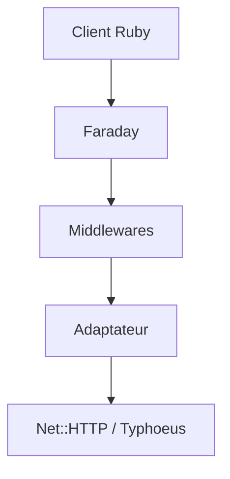

# lostisland/faraday

> HTTP client abstraction layer for Ruby, with Rack-style middlewares, for API developers.

## The problem
Writing Ruby API clients without being tied to a specific HTTP adapter.

## What it actually does
A common interface over Net::HTTP, Typhoeus, Patron, Excon, HTTPClient; middlewares to modify requests and responses; persistent connections, parallel requests, JSON/XML/YAML parsing, streaming, file upload.

## How it is wired

Diagram based on the README, no diagram provided.

## Trying it
```bash
# non documenté dans le README fourni (voir le site lostisland.github.io/faraday)
```

## Cost and gotchas
Free. Ruby ecosystem only: useless for a Python or JavaScript project. The choice of HTTP adapter (Net::HTTP, Typhoeus, Excon…) changes the behaviour of parallel requests and streaming.

## What it is not
Not a full HTTP client: a layer on top of other adapters.

## Alternatives
No named alternative (Awesome Faraday list for the adapters).

## For you
Ignore: Ruby, of no interest for a Python data/AI profile.
