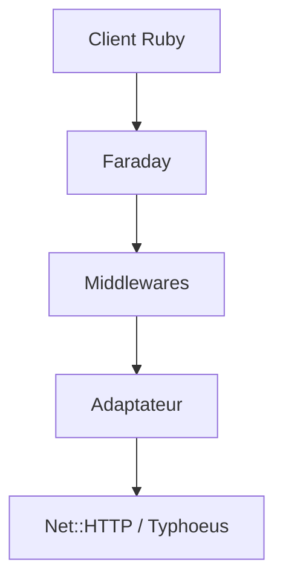

# lostisland/faraday

> Couche d'abstraction de client HTTP pour Ruby, avec middlewares à la Rack, pour développeurs d'API.

## Le problème
Écrire des clients d'API Ruby sans se lier à un adaptateur HTTP précis.

## Ce que ça fait vraiment
Interface commune sur Net::HTTP, Typhoeus, Patron, Excon, HTTPClient ; middlewares pour modifier requêtes et réponses ; connexions persistantes, requêtes parallèles, analyse JSON/XML/YAML, streaming, envoi de fichiers.

## Comment c'est branché

Schéma d'après le README, pas de diagramme fourni.

## Essayer
```bash
# non documenté dans le README fourni (voir le site lostisland.github.io/faraday)
```

## Coût et pièges
Gratuit. Écosystème Ruby uniquement.

## Ce que ce n'est pas
Pas un client HTTP à part entière : une couche sur d'autres adaptateurs.

## Alternatives
Aucune alternative nommée (liste Awesome Faraday pour les adaptateurs).

## Pour toi
Ignorer : Ruby, sans intérêt pour un profil data/IA en Python.

