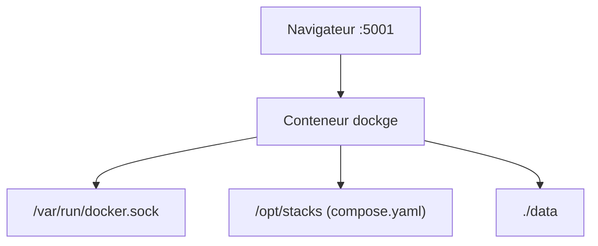

# louislam/dockge

> Reactive web interface to manage docker compose.yaml stacks, for self-hosters.

## The problem
Managing compose files by hand over SSH is painful, and the author finds Portainer unclear for stacks.

## What it actually does
Create, edit, start, stop and delete stacks from a browser, with a compose.yaml editor and a web terminal. Files stay on disk, usable with `docker compose`. Converts a `docker run` into compose. Several Docker hosts from a single interface (1.4.0).

## How it is wired


## Trying it
```bash
mkdir -p /opt/stacks /opt/dockge
cd /opt/dockge
curl https://raw.githubusercontent.com/louislam/dockge/master/compose.yaml --output compose.yaml
docker compose up -d
```

## Cost and gotchas
Free. The stacks path must be identical on the host and in the container, otherwise data ends up in the wrong place. The Docker socket is mounted.

## What it is not
Not a full Portainer replacement: no management of networks or of standalone containers without compose. Windows not supported.

## Alternatives
Portainer: more Docker features (networks, standalone containers).

## For you
Adopt to drive lab MLOps stacks in compose: lightweight, files are not locked in; with no visible backup maintainer, do not make it a critical point.
