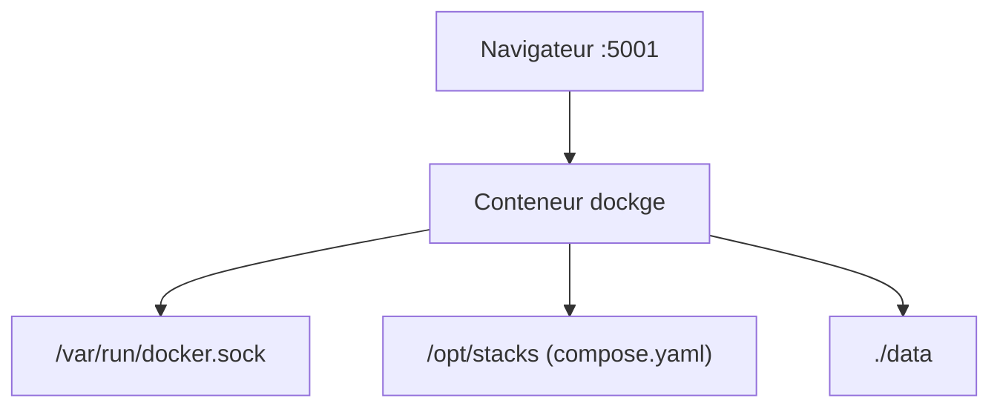

# louislam/dockge

> Interface web réactive pour gérer des stacks docker compose.yaml, pour qui s'auto-héberge.

## Le problème
Gérer des fichiers compose à la main en SSH est pénible, et Portainer est jugé peu clair par l'auteur pour les stacks.

## Ce que ça fait vraiment
Créer, éditer, démarrer, arrêter, supprimer des stacks depuis un navigateur, avec éditeur compose.yaml et terminal web. Les fichiers restent sur disque, utilisables avec `docker compose`. Convertit un `docker run` en compose. Plusieurs hôtes Docker depuis une seule interface (1.4.0).

## Comment c'est branché


## Essayer
```bash
mkdir -p /opt/stacks /opt/dockge
cd /opt/dockge
curl https://raw.githubusercontent.com/louislam/dockge/master/compose.yaml --output compose.yaml
docker compose up -d
```

## Coût et pièges
Gratuit. Le chemin des stacks doit être identique côté hôte et conteneur, sinon les données vont au mauvais endroit. Le socket Docker est monté.

## Ce que ce n'est pas
Pas un remplaçant complet de Portainer : pas de gestion de réseaux ni de conteneurs isolés sans compose. Windows non supporté.

## Alternatives
Portainer : plus de fonctions Docker (réseaux, conteneurs seuls).

## Pour toi
À adopter pour piloter des stacks MLOps de labo en compose : léger, fichiers non captifs ; sans mainteneur de rechange visible, ne pas en faire un point critique.

