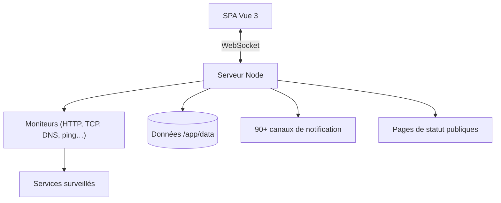

# louislam/uptime-kuma

> Self-hosted availability monitoring, a free alternative to services like Uptime Robot.

## The problem
Assuming that a service has failed implies that there is either a third-party payment system in place, or a manually created cron script with no history.
Furthermore, a user-friendly status page is necessary.

## What it actually does
Monitors HTTP(S), the keyword "HTTP", JSON requests, TCP, WebSocket, ping, DNS records, push notifications,
Steam game servers and Docker containers, at decreasing intervals of 20 seconds.
Notifies via Telegram, Discord, Gotify, Slack, Pushover, SMTP email, and over 90 other services.
Multiple status pages, which can be mapped to dedicated domains; certificate information, proxy settings, 2FA, and multilingual support.

## How it is wired


## Trying it
```bash
mkdir uptime-kuma && cd uptime-kuma
curl -o compose.yaml https://raw.githubusercontent.com/louislam/uptime-kuma/master/compose.yaml
docker compose up -d
docker run -d --restart=always -p 3001:3001 -v uptime-kuma:/app/data --name uptime-kuma louislam/uptime-kuma:2
```

## Cost and gotchas
Free. Default listening on all interfaces in 3001: restrict to `127.0.0.1` behind a proxy.
Network file systems such as NFS are not supported for the data volume.

## What it is not
Not a observability platform: no application metrics, traces, or logs.
No multi-site distributed monitoring – a single instance probes from a single location.
FreeBSD, OpenBSD, NetBSD, Replit, and Heroku are not supported.

## Alternatives
None are listed in the README file, except for `statping`, which is noted as being unmaintained.

## For you
The quickest way to monitor inference endpoints and jobs. Highly recommended.
