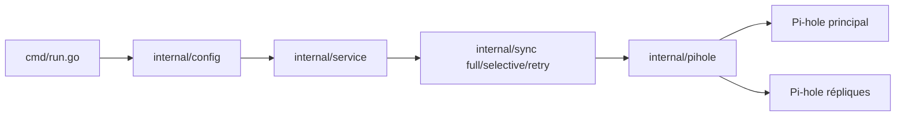

# lovelaze/nebula-sync

> Copies the configuration of a primary Pi-hole v6 to its replicas, for anyone running several.

## The problem
With several Pi-holes, every DNS setting, list or group has to be redone by hand on each instance, and the servers drift apart.

## What it actually does
A Go executable (or container) reads `PRIMARY` and `REPLICAS` from the environment, exports the primary's config via the Pi-hole API, then imports it on each replica. Two modes: full sync through Teleporter (`FULL_SYNC=true`) or selective, with include/exclude filters per section. A cron schedule is built in, with success/failure webhooks. Unofficial project, unrelated to Pi-hole.

## How it is wired


## Trying it
```bash
docker run --rm \
  --name nebula-sync \
  -e PRIMARY="http://ph1.example.com|password" \
  -e REPLICAS="http://ph2.example.com|password" \
  -e FULL_SYNC=true \
  -e RUN_GRAVITY=true \
  ghcr.io/lovelaze/nebula-sync:latest
```

## Cost and gotchas
Free; you need at least two Pi-hole v6 instances and their passwords in plain text in the environment (Docker secrets possible). The container runs as user 1001: secret files must be readable by it. With application passwords, enable `webserver.api.app_sudo` on the replicas.

## What it is not
Not an official Pi-hole module. Config filters only apply when `FULL_SYNC=false`, and are case-sensitive. No high availability: it is a config copy, not real-time replication.

## Alternatives
No alternative named in the README.

## For you
Ignore: it is home network administration, unrelated to data/AI/MLOps work, unless you run several Pi-holes yourself.
