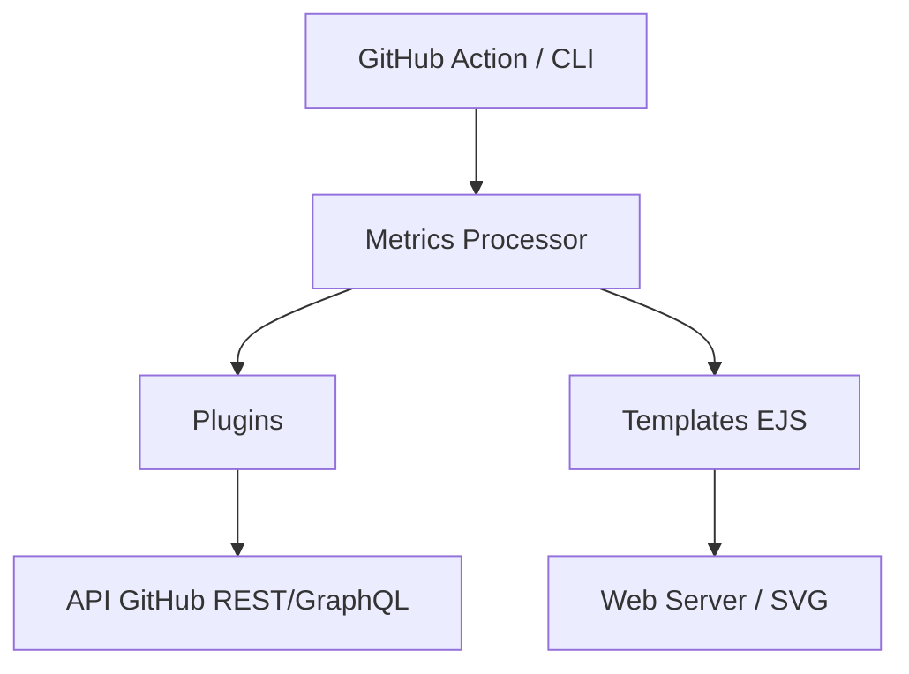

# lowlighter/metrics

> Generator of SVG images of GitHub statistics to embed in a profile or a README.

## The problem
To display your GitHub activity, languages or stars, you have to assemble several badge services.

## What it actually does
More than 47 plugins (calendar, languages, lines of code, WakaTime, Leetcode, Steam…) and 4 templates.
The main mode runs as a GitHub Action. There is also a shared instance, a web instance you can host yourself, and one-off Docker usage.
Data comes from the GitHub REST and GraphQL APIs, then goes through EJS templates.

## How it is wired

## Trying it
The README describes several installation modes (Action, shared instance, Docker) but gives no commands.

## Cost and gotchas
A GitHub token is required. On the shared instance, compute-heavy features are disabled.

## What it is not
It has nothing to do with monitoring models or services. Avoid the `@master` version, which is a beta.

## Alternatives
The README names no alternative repository.

## For you
Ignore: it is a GitHub showcase gadget, unrelated to your data/AI work.
