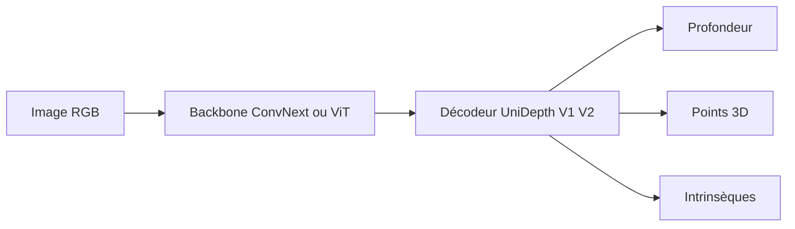

# lpiccinelli-eth/UniDepth

> Metric depth models from a single RGB image, with intrinsics estimation.

## The problem
Getting depth in meters from a photo without knowing the camera, across varied scenes and sensors.

## What it actually does
Loads UniDepthV1 (CVPR 2024) or V2 from Hugging Face or TorchHub, predicts depth, a 3D point cloud and intrinsics, or uses the provided intrinsics (Pinhole or Fisheye624 cameras for V2). V2 adds edge sharpness, confidence, flexible inputs, ONNX.

## How it is wired


## Trying it
```bash
pip install -e . --extra-index-url https://download.pytorch.org/whl/cu118
python ./scripts/demo.py
```
```python
from unidepth.models import UniDepthV1
model = UniDepthV1.from_pretrained("lpiccinelli/unidepth-v1-vitl14")
predictions = model.infer(rgb)
```

## Cost and gotchas
Linux, Python 3.10+, CUDA 11.8+; KNN operations to compile for evaluation; xFormers/Triton errors possible if the CUDA versions differ. The license is present but not identified. The model table lists `unidepth-v2-vits14` for both ViT-S and ViT-B: probable typo.

## What it is not
Not a product: a research repository (V2 "under submission"). The table results concern V1; V2 appears there with empty cells.

## Alternatives
Compared in the table: Metric3Dv2, DepthPro, ZoeDepth, iDisc.

## For you
Keep an eye on it: good zero-shot numbers, but unclear license and last push in May 2025 before any production use.
