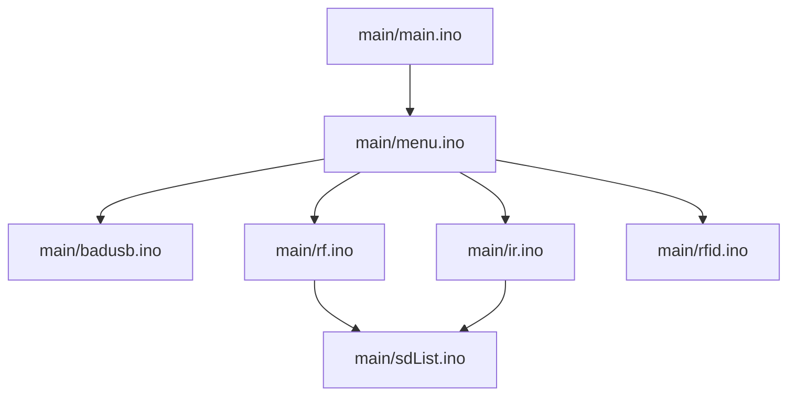

# lraton/FlopperZiro

> DIY hardware multi-tool on STM32, inspired by the Flipper Zero, for electronics hobbyists.

## The problem
The Flipper Zero is expensive. This repository offers a build-it-yourself version to explore RF, NFC, infrared and BadUSB.

## What it actually does
Arduino firmware for an STM32-L432KC with an OLED screen, a microSD reader and six buttons. Menus for BadUSB (Rubber Ducky scripts from the SD card), RFID/NFC (UID reading, emulation), 433 MHz RF (capture/replay), infrared. The roadmap remains open: ISO14443-B, PN7150 and assembly documentation are unchecked.

## How it is wired


## Trying it
```bash
# Aucune commande documentée : le firmware se compile et se téléverse depuis l'Arduino IDE.
```

## Cost and gotchas
No API key, but hardware to buy and solder (STM32, PN532, FS1000A/RXB12, OLED, TP4056). Assembly documentation is still incomplete.

## What it is not
Not a finished product nor a replacement for the Flipper Zero. The README specifies educational use, no unauthorized security testing.

## Alternatives
- Flipper Zero: a polished device, with maintained firmware and ecosystem.

## For you
Ignore: embedded electronics unrelated to data/AI/MLOps, and a project still under construction.
