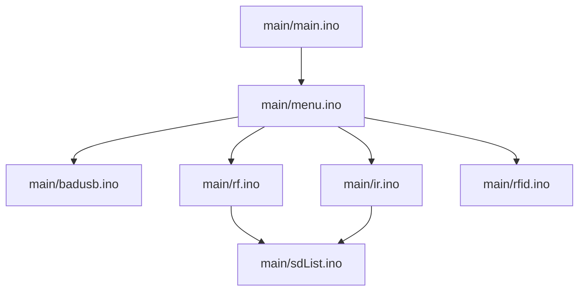

# lraton/FlopperZiro

> Multi-outil matériel DIY sur STM32, inspiré du Flipper Zero, pour bricoleurs d'électronique.

## Le problème
Le Flipper Zero coûte cher. Ce dépôt propose une version à monter soi-même pour explorer RF, NFC, infrarouge et BadUSB.

## Ce que ça fait vraiment
Firmware Arduino pour un STM32-L432KC avec écran OLED, lecteur microSD et six boutons. Menus pour BadUSB (scripts Rubber Ducky depuis la SD), RFID/NFC (lecture d'UID, émulation), RF 433 MHz (capture/rejeu), infrarouge. La feuille de route reste ouverte : ISO14443-B, PN7150 et documentation de montage non cochés.

## Comment c'est branché


## Essayer
```bash
# Aucune commande documentée : le firmware se compile et se téléverse depuis l'Arduino IDE.
```

## Coût et pièges
Pas de clé d'API, mais du matériel à acheter et souder (STM32, PN532, FS1000A/RXB12, OLED, TP4056). Documentation de montage encore incomplète.

## Ce que ce n'est pas
Pas un produit fini ni un remplaçant du Flipper Zero. Le README précise un usage éducatif, pas de test de sécurité non autorisé.

## Alternatives
- Flipper Zero : matériel abouti, firmware et écosystème maintenus.

## Pour toi
Ignorer : de l'électronique embarquée sans lien avec data/IA/MLOps, et un projet encore en chantier.

