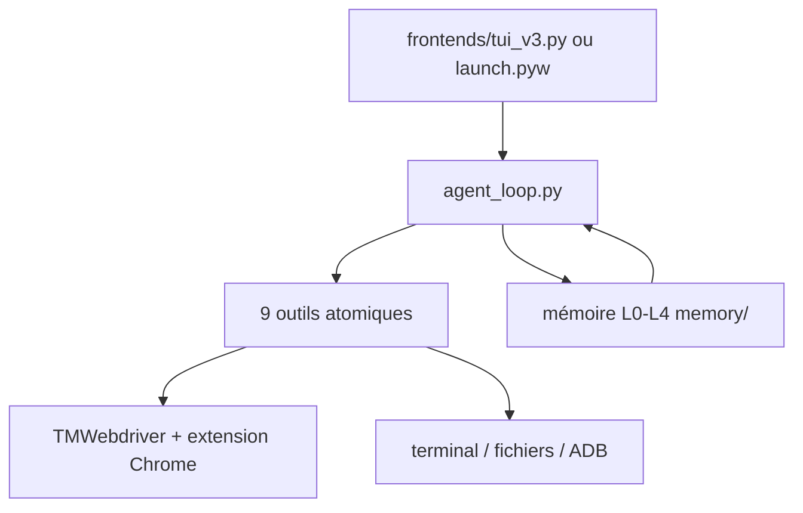

# lsdefine/GenericAgent

> Minimal autonomous agent that takes control of a workstation's system and accumulates its own skills.

## The problem
Agent frameworks weigh hundreds of thousands of lines and start from scratch in every session,
without building on what they have learned.

## What it actually does
~3K lines of code, 9 atomic tools (`code_run`, `file_read`, `file_write`, `file_patch`,
`web_scan`, `web_execute_js`, `ask_user`, plus two memory tools) and an agent loop of about
100 lines in `agent_loop.py`. Each solved task is frozen into a "Skill" in a hierarchical
L0-L4 memory. TMWebdriver injects the agent into a real persistent Chrome, with cookies and login
session preserved, rather than a throwaway headless one.

## How it is wired


## Trying it
```bash
git clone https://github.com/lsdefine/GenericAgent.git && cd GenericAgent
uv venv && uv pip install -e ".[ui]"
cp mykey_template_en.py mykey.py
python frontends/tui_v3.py
```

## Cost and gotchas
Python 3.11 or 3.12 required, not 3.14. LLM API key at your expense. The "one-line" installer
runs a remote script via `irm | iex` or `curl | bash`, including from a third-party host
(`fudankw.cn:9000`) in the Chinese section. The preinstalled SOPs are in Chinese.

## What it is not
It is not a sandboxed agent: it drives a real browser, the keyboard, the mouse and the ADB
of the workstation. The README claims to bypass bot detection (SannySoft, reCAPTCHA v3 at
0.9) — this is an explicit goal of the product, not a side effect. The token and
line-count comparisons against Claude Code or OpenClaw are the author's own figures.

## Alternatives
The README cites OpenClaw and Claude Code as points of comparison, and community GUIs
(`chilishark27/ga-manager`, `wangjc683/galley`, `Fwind43/GenericAgent-Admin`).

## For you
The unsandboxed system control and the openly stated detection bypass make the tool
unsuitable for a professional workstation.
