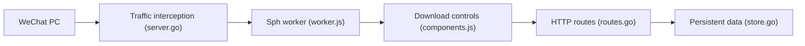

# ltaoo/wx_channels_download

> WeChat Channels video downloader (Windows, macOS) that intercepts the PC client's traffic.

## The problem
WeChat "Channels" videos cannot be downloaded directly from the PC client.

## What it actually does
Runs a local service as administrator, installs a certificate on first start and intercepts WeChat PC traffic. A download button is injected into the video interface, with quality selection. The code also contains a management interface, download tasks and scrapers for other platforms. Decryption is inspired by two cited third-party projects.

## How it is wired


## Trying it
```bash
# Développement (terminal lancé en administrateur)
go run main.go
# Empaquetage : voir build/build.sh
```

## Cost and gotchas
Free. Requires administrator rights and installation of a root certificate: a real risk surface. README in Chinese.

## What it is not
Not a validated tool: usage disclaimer for "technical and study" purposes only. License present but unidentified. May violate WeChat's terms of service.

## Alternatives
None named; the README only cites WechatVideoSniffer2.0 and WechatSphDecrypt as sources for the decryption.

## For you
Ignore: outside the data/AI scope, and it imposes a root certificate with admin rights for a marginal gain.
