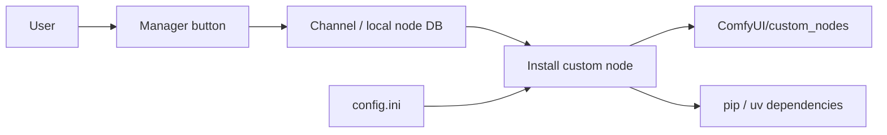

# ltdrdata/ComfyUI-Manager

> ComfyUI extension to install, update and disable custom nodes and to download models.

## The problem
Managing dozens of custom nodes, their pip dependencies and their versions in ComfyUI by hand.

## What it actually does
Adds a "Manager" menu: catalog of nodes and models (database channels), installation, updates, restorable snapshots, shareable components, workflow sharing, cm-cli without ComfyUI. `config.ini` sets the security level, network mode and use of uv. Installs from git URLs and pip are disabled by default.

## How it is wired


## Trying it
```bash
cd ComfyUI/custom_nodes
git clone https://github.com/ltdrdata/ComfyUI-Manager comfyui-manager
pip install comfy-cli
comfy install
```

## Cost and gotchas
Free. Installing third-party code (nodes, pip) carries risks: set `security_level` and the flags `allow_git_url_install`, `allow_pip_install` (default false, loopback only). ComfyUI restart required.

## What it is not
Does not guarantee that installed nodes work properly (explicit warning). Only works with ComfyUI.

## Alternatives
The README cites comfy-cli and the registry registry.comfy.org.

## For you
Worth watching: useful if you use ComfyUI for image generation; the attack surface of third-party nodes means keeping the security level strict.
