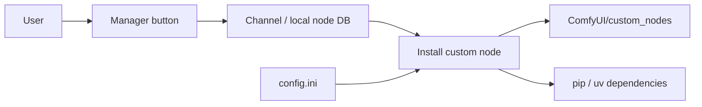

# ltdrdata/ComfyUI-Manager

> Extension de ComfyUI pour installer, mettre à jour, désactiver des nœuds personnalisés et télécharger des modèles.

## Le problème
Gérer à la main des dizaines de nœuds personnalisés, leurs dépendances pip et leurs versions dans ComfyUI.

## Ce que ça fait vraiment
Ajoute un menu « Manager » : catalogue de nœuds et de modèles (canaux de base de données), installation, mises à jour, instantanés restaurables, composants partageables, partage de workflows, cm-cli sans ComfyUI. `config.ini` règle niveau de sécurité, mode réseau, usage d'uv. Les installations par URL git et pip sont désactivées par défaut.

## Comment c'est branché


## Essayer
```bash
cd ComfyUI/custom_nodes
git clone https://github.com/ltdrdata/ComfyUI-Manager comfyui-manager
pip install comfy-cli
comfy install
```

## Coût et pièges
Gratuit. Installer du code tiers (nœuds, pip) a des risques : règle `security_level` et les drapeaux `allow_git_url_install`, `allow_pip_install` (défaut false, loopback seulement). Redémarrage de ComfyUI requis.

## Ce que ce n'est pas
Ne garantit pas le bon fonctionnement des nœuds installés (avertissement explicite). Ne sert qu'avec ComfyUI.

## Alternatives
Le README cite comfy-cli et le registre registry.comfy.org.

## Pour toi
À surveiller : utile si tu utilises ComfyUI pour de la génération d'images ; la surface d'attaque des nœuds tiers impose de garder le niveau de sécurité strict.

