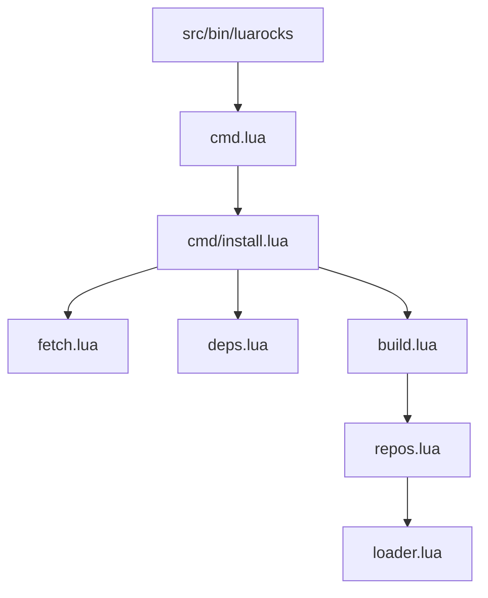

# luarocks/luarocks

> Package manager for Lua modules, installed as local or remote "rocks".

## The problem
Installing and versioning Lua modules and their dependencies by hand quickly becomes unmanageable.

## What it actually does
- Installs modules as self-contained packages, the "rocks".
- Manages local and remote repositories and several local trees.
- For `install`: finds the rock, downloads it (git or otherwise), resolves dependencies, builds it and registers it.
- A loader makes it findable at `require`.

## How it is wired

## Trying it
No command documented in the README (points to the luarocks.org site).

## Cost and gotchas
Free. Assumes a Lua interpreter; C modules require a compiler (not specified in the README).

## What it is not
Not a manager for other languages. The README is very short: the detail is on the site.

## Alternatives
No alternative named in the README.

## For you
Ignore unless you work with Lua (Neovim, embedded scripts): no link with data / AI / MLOps toolchains.
