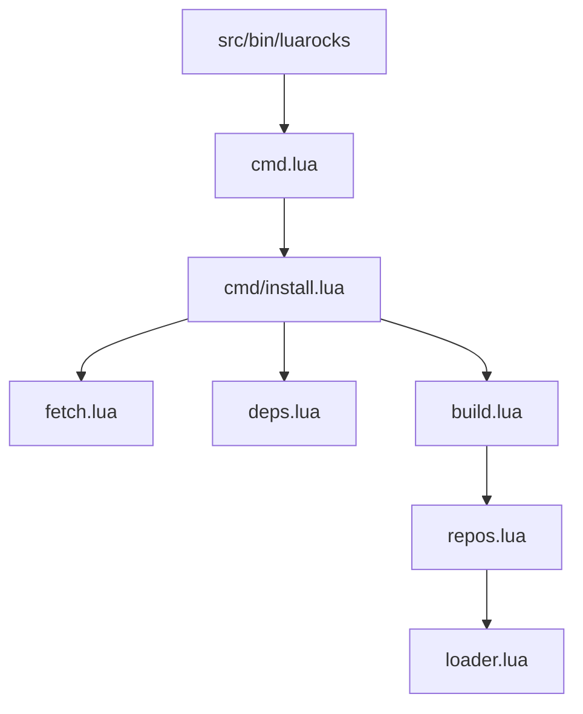

# luarocks/luarocks

> Gestionnaire de paquets pour modules Lua, installés sous forme de « rocks » locaux ou distants.

## Le problème
Installer et versionner des modules Lua et leurs dépendances à la main devient vite ingérable.

## Ce que ça fait vraiment
- Installe des modules comme paquets autonomes, les « rocks ».
- Gère des dépôts locaux et distants et plusieurs arbres locaux.
- Pour `install` : cherche le rock, le télécharge (git ou autre), résout les dépendances, le compile et l'enregistre.
- Un chargeur permet de le retrouver au `require`.

## Comment c'est branché

## Essayer
Aucune commande documentée dans le README (renvoi au site luarocks.org).

## Coût et pièges
Gratuit. Suppose un interpréteur Lua ; les modules C demandent un compilateur (non précisé dans le README).

## Ce que ce n'est pas
Pas un gestionnaire pour d'autres langages. Le README est très court : le détail est sur le site.

## Alternatives
Aucune alternative nommée dans le README.

## Pour toi
À ignorer sauf si tu touches à Lua (Neovim, scripts embarqués) : aucun lien avec les chaînes data / IA / MLOps.

