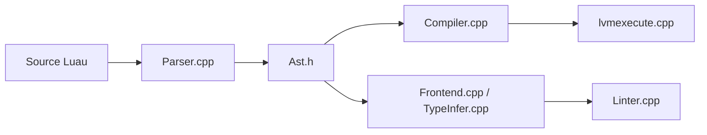

# luau-lang/luau

> Embeddable, gradually typed scripting language derived from Lua, used notably by Roblox.

## The problem
Embedding a fast, sandboxed, typed scripting language in an application, without rewriting everything from Lua 5.1.

## What it actually does
Lua 5.1 compatible, with type annotations and inference. The parser produces an AST, then the compiler generates bytecode for the VM, or the analyzer emits type diagnostics and lint. Two tools: `luau` (REPL, file execution) and `luau-analyze`. Optional native code generation.

## How it is wired


## Trying it
```bash
mkdir cmake && cd cmake
cmake .. -DCMAKE_BUILD_TYPE=RelWithDebInfo
cmake --build . --target Luau.Repl.CLI --config RelWithDebInfo
```

## Cost and gotchas
Free. No `__gc`; compilation is done separately from loading; call `luaL_sandbox` for security.

## What it is not
Not standard Lua: heavily modified runtime, a few API incompatibilities.

## Alternatives
No alternative named in the README.

## For you
Ignore: relevant for games and embedded scripting, not for data/AI/MLOps.
