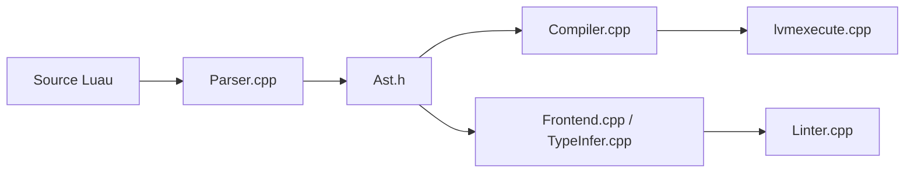

# luau-lang/luau

> Langage de script embarquable, typé graduellement et dérivé de Lua, utilisé notamment par Roblox.

## Le problème
Embarquer un langage de script rapide, sandboxé et typé dans une application, sans tout réécrire depuis Lua 5.1.

## Ce que ça fait vraiment
Compatible Lua 5.1 avec annotations de types et inférence. Le parseur produit un AST, puis le compilateur génère du bytecode pour la VM, ou l'analyse émet diagnostics de types et lint. Deux outils : `luau` (REPL, exécution de fichiers) et `luau-analyze`. Génération de code natif en option.

## Comment c'est branché


## Essayer
```bash
mkdir cmake && cd cmake
cmake .. -DCMAKE_BUILD_TYPE=RelWithDebInfo
cmake --build . --target Luau.Repl.CLI --config RelWithDebInfo
```

## Coût et pièges
Gratuit. Pas de `__gc` ; la compilation se fait séparément du chargement ; appeler `luaL_sandbox` pour la sécurité.

## Ce que ce n'est pas
Pas un Lua standard : runtime très modifié, quelques incompatibilités d'API.

## Alternatives
Aucune alternative nommée dans le README.

## Pour toi
À ignorer : pertinent pour jeux et scripts embarqués, pas pour data/IA/MLOps.

