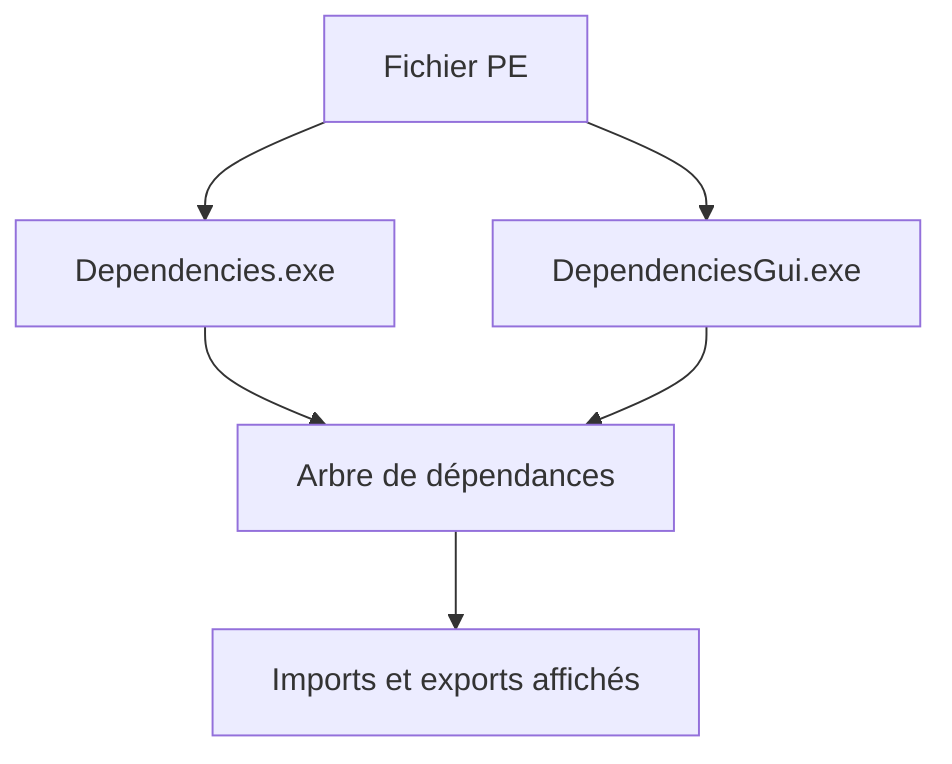

# lucasg/Dependencies

> Modern rewrite of Dependency Walker for diagnosing DLL problems on Windows.

## The problem
Understanding why a Windows application fails to load a DLL, when the historical tool has not been maintained since 2006.

## What it actually does
It analyzes a PE executable and displays its direct, redirected and delay-loaded dependencies, with api sets and CLR assemblies. Two binaries: `Dependencies.exe` (command line) and `DependenciesGui.exe`. Dynamic loading through `LoadLibrary` is not handled.

## How it is wired
Simplified diagram based on the sheet, no diagram provided.


## Trying it
```bash
# Télécharger une release, décompresser l'archive, puis lancer :
DependenciesGui.exe
```

## Cost and gotchas
Free. Windows only, with Visual C++ Redistributable; unsigned binary so SmartScreen may warn. The full recursive mode can exceed one GB of memory.

## What it is not
Not a cross-platform tool nor a dynamic load analyzer. Last push in May 2024.

## Alternatives
- Dependency Walker (depends.exe): the historical tool it replaces.

## For you
Ignore: it is a Windows debugging tool unrelated to data, AI or MLOps.
