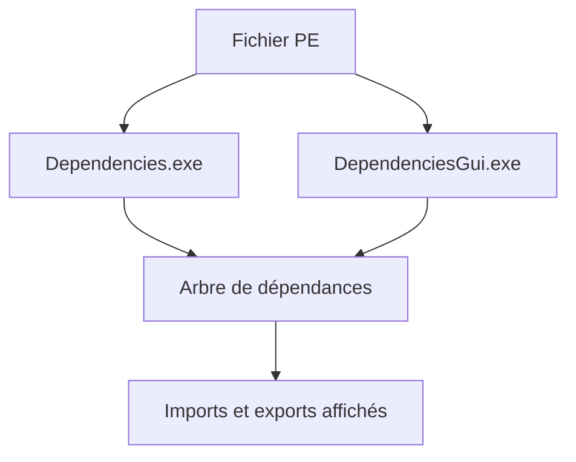

# lucasg/Dependencies

> Réécriture moderne de Dependency Walker pour diagnostiquer les problèmes de DLL sous Windows.

## Le problème
Comprendre pourquoi une application Windows ne charge pas une DLL, alors que l'outil historique n'est plus maintenu depuis 2006.

## Ce que ça fait vraiment
Il analyse un exécutable PE et affiche ses dépendances directes, redirigées et à chargement différé, avec les api sets et les assemblées CLR. Deux binaires : `Dependencies.exe` (ligne de commande) et `DependenciesGui.exe`. Le chargement dynamique par `LoadLibrary` n'est pas géré.

## Comment c'est branché
Schéma simplifié d'après la fiche, sans diagramme fourni.


## Essayer
```bash
# Télécharger une release, décompresser l'archive, puis lancer :
DependenciesGui.exe
```

## Coût et pièges
Gratuit. Windows uniquement, avec Visual C++ Redistributable ; binaire non signé donc SmartScreen peut alerter. Le mode récursif complet peut dépasser un Go de mémoire.

## Ce que ce n'est pas
Pas un outil multiplateforme ni un analyseur de chargements dynamiques. Dernier push en mai 2024.

## Alternatives
- Dependency Walker (depends.exe) : l'outil historique qu'il remplace.

## Pour toi
À ignorer : c'est un outil de débogage Windows sans rapport avec la data, l'IA ou le MLOps.

