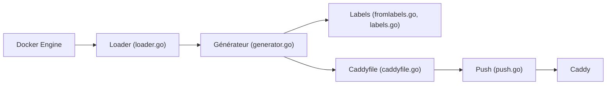

# lucaslorentz/caddy-docker-proxy

> Caddy plugin that configures a reverse proxy from Docker container labels, for homelabs and small Swarm clusters.

## The problem
Maintaining a Caddyfile by hand every time a Docker service is added or removed is tedious and easy to get wrong.

## What it actually does
It reads Docker metadata, finds labels prefixed with `caddy`, generates a Caddyfile in memory and triggers a zero-downtime reload on every change. Labels translate into directives (`caddy.reverse_proxy: "{{upstreams 80}}"`), with Go templates. It targets containers or Swarm services. Three modes: standalone (default), controller and server. Automatic HTTPS through Let's Encrypt/ZeroSSL.

## How it is wired


## Trying it
```bash
docker network create caddy --ipv6
docker compose up -d
docker run --name caddy -d -p 443:443 -v /var/run/docker.sock:/var/run/docker.sock lucaslorentz/caddy-docker-proxy:ci-alpine
```

## Cost and gotchas
Free. The controller needs access to the Docker socket (a sensitive surface). Persistent `/data` volume required, otherwise certificates are re-issued and Let's Encrypt quotas are hit. `ci` images are unstable.

## What it is not
Not an orchestrator or a service mesh. Automatic detection of the ingress network sometimes fails: set `CADDY_INGRESS_NETWORKS`.

## Alternatives
Not documented in the README: no alternative named.

## For you
Handy for cleanly exposing ML services (Jupyter, MLflow, APIs) on a single Docker server with HTTPS; pointless if you are already on Kubernetes.
