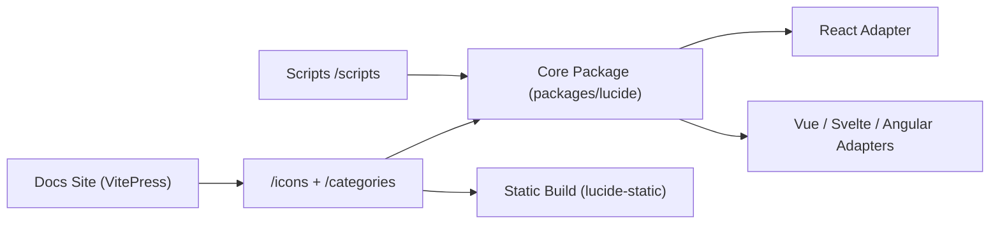

# lucide-icons/lucide

> Open-source SVG icon library with per-framework packages, for designers and front-end developers.

## The problem
Keeping a consistent, lightweight icon set across several front-end frameworks.

## What it actually does
Publishes more than 1600 vector icons and dedicated npm packages: `lucide`, `lucide-react`, `@lucide/vue`, `@lucide/svelte`, `lucide-solid`, `lucide-preact`, `lucide-react-native`, `@lucide/angular`, `@lucide/astro`, `lucide-static`. A Figma plugin exists. The README rejects brand logos. From the code: a pnpm monorepo, icons in JSON, generation scripts, and a VitePress docs site.

## How it is wired

## Trying it
No installation command in the README provided (the npm packages are listed, the docs are online).

## Cost and gotchas
Free. The license is present but not identified by GitHub: read the LICENSE file before commercial use.

## What it is not
It is not a set of brand icons. Nor is it a UI component library.

## Alternatives
No alternative named in the README.

## For you
Watch: useful for dressing up a dashboard or an AI app (not relevant for Streamlit, relevant for React), with no data stakes; check the exact license.
