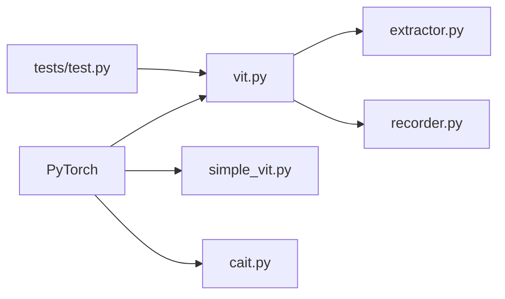

# lucidrains/vit-pytorch

> PyTorch collection of dozens of Vision Transformer variants, for vision researchers and practitioners.

## The problem
Comparing or prototyping ViT variants means reimplementing each paper, with its attention and patch subtleties.

## What it actually does
Each variant is a standalone module: ViT, SimpleViT, NaViT, CaiT, T2T, CCT, CrossViT, MaxViT, MobileViT, 3D ViT, ViViT…
Training strategies: distillation, SimMIM, MAE, Dino, EsViT, patch prediction.
`Recorder` wrappers (attention maps) and `Extractor` (embeddings).
No pre-trained weights: the README points elsewhere for those.

## How it is wired


## Trying it
```bash
pip install vit-pytorch
```

## Cost and gotchas
Free, MIT. Training from scratch is GPU-expensive since no weights are provided.

## What it is not
Not a hub of pre-trained models. Paper implementations, not validated reproductions of the reported scores.

## Alternatives
- Ross Wightman's repository (timm): PyTorch ViT with pre-trained weights.
- Official Jax repository: reference implementation.

## For you
Adopt as a code reference: ideal for understanding or prototyping a ViT variant, knowing that timm is needed for ready-to-use weights.
