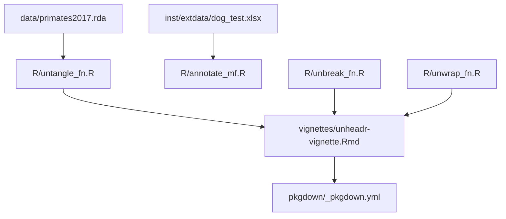

# luisDVA/unheadr

> R package for cleaning tables with embedded subheadings or values split across several rows.

## The problem
Tables that are easy on the eye (subheadings in the middle, split cells) are hard to analyze by group.

## What it actually does
`untangle2()` extracts embedded subheadings into their own columns using a regular expression. `unbreak_vals()`, `unbreak_rows()` and `unwrap_cols()` glue split values back together. `mash_colnames()` merges headers spread over several rows. `annotate_mf()` converts spreadsheet formatting into text, and `regex_valign()` aligns whitespace.

## How it is wired


## Trying it
```bash
Rscript -e 'install.packages("unheadr")'
```
```r
library(unheadr)
untangle2(...)
```

## Cost and gotchas
No cost. The regular expressions must be chosen by hand for each dataset. A license is present but not identified by GitHub.

## What it is not
Not an automatic cleaning tool: you have to describe the patterns to look for.

## Alternatives
No alternative named in the README.

## For you
Worth watching: handy for recovering badly formed spreadsheets in R; in Python, you would do the same thing with pandas.
