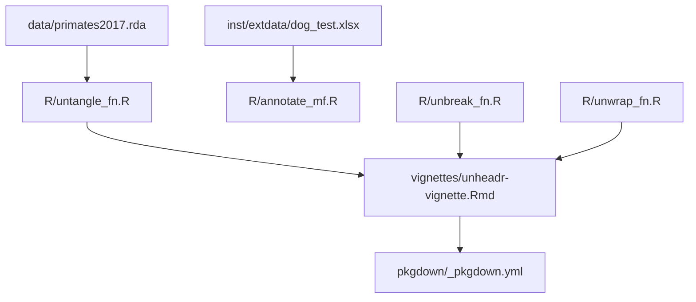

# luisDVA/unheadr

> Paquet R pour nettoyer des tableaux à sous-titres intégrés ou à valeurs coupées sur plusieurs lignes.

## Le problème
Des tableaux lisibles pour l'œil (sous-titres au milieu, cellules coupées) sont difficiles à analyser par groupe.

## Ce que ça fait vraiment
`untangle2()` extrait les sous-titres intégrés vers leurs propres colonnes par expression régulière. `unbreak_vals()`, `unbreak_rows()` et `unwrap_cols()` recollent des valeurs coupées. `mash_colnames()` fusionne des en-têtes sur plusieurs lignes. `annotate_mf()` convertit la mise en forme des tableurs en texte, et `regex_valign()` aligne les espaces.

## Comment c'est branché


## Essayer
```bash
Rscript -e 'install.packages("unheadr")'
```
```r
library(unheadr)
untangle2(...)
```

## Coût et pièges
Aucun coût. Les expressions régulières doivent être choisies à la main pour chaque jeu de données. Licence présente mais non identifiée par GitHub.

## Ce que ce n'est pas
Pas un outil de nettoyage automatique : il faut décrire les motifs à repérer.

## Alternatives
Aucune alternative nommée dans le README.

## Pour toi
À surveiller : pratique pour récupérer des tableurs mal formés en R ; en Python, on fera la même chose avec pandas.

