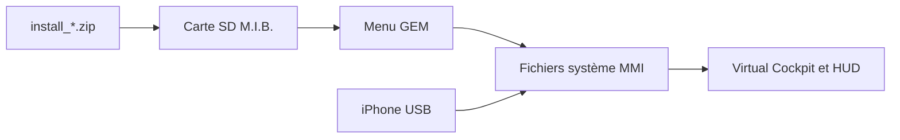

# luka-dev/mib2q-carplay-rgi

> Modification for Audi MHI2Q systems: CarPlay map, guidance, calls and 5.1 sound on the Virtual Cockpit.

## The problem
On an Audi MHI2Q, CarPlay stays on the central screen; the instrument cluster shows neither map nor guidance.

## What it actually does
Replaces MMI system files via M.I.B. to display the map and guidance arrows on the Virtual Cockpit and the HUD, along with calls and album covers. Adds 5.1 sound and an "UpMix" for external amplifiers. Settings are in the vehicle menu.

## How it is wired
Simplified diagram based on the sheet, no diagram provided.

## Trying it
No command: copy the `mod` folder to the M.I.B. SD card, run "Run Custom Script" from the GEM menu, wait for "DONE (install)", restart.

## Cost and gotchas
The MMI must be updated first: on software that is too old, the unit can stay stuck on the logo. Backups do not guarantee recovery. Conflicts with other CarPlay mods.

## What it is not
Not an Audi product, not a universal fix: only the MHI2Q versions listed. The authors disclaim all responsibility (warranty, bricked unit).

## Alternatives
- adi961/mib2-android-auto-vc: earlier work cited in the README.
- OneB1t/VcMOSTRenderMqb: other work cited.

## For you
Ignore: risky car tinkering, unrelated to your data/AI/MLOps work.
