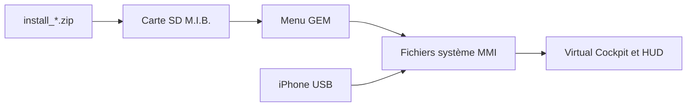

# luka-dev/mib2q-carplay-rgi

> Modification pour systèmes Audi MHI2Q : carte CarPlay, guidage, appels et son 5.1 sur le Virtual Cockpit.

## Le problème
Sur un Audi MHI2Q, CarPlay reste sur l'écran central ; le combiné d'instruments n'affiche ni carte ni guidage.

## Ce que ça fait vraiment
Remplace des fichiers système du MMI via M.I.B. pour afficher la carte et les flèches de guidage sur le Virtual Cockpit et le HUD, les appels et les pochettes d'album. Ajoute le son 5.1 et un « UpMix » pour amplis externes. Réglages dans le menu du véhicule.

## Comment c'est branché
Schéma simplifié d'après la fiche, sans diagramme fourni.

## Essayer
Aucune commande : copier le dossier `mod` sur la carte SD M.I.B., lancer « Run Custom Script » depuis le menu GEM, attendre « DONE (install) », redémarrer.

## Coût et pièges
Il faut mettre à jour le MMI avant : sur un logiciel trop ancien, l'unité peut rester bloquée sur le logo. Les sauvegardes ne garantissent pas la récupération. Conflit avec d'autres mods CarPlay.

## Ce que ce n'est pas
Pas un produit Audi, pas un correctif universel : seulement les versions MHI2Q listées. Les auteurs refusent toute responsabilité (garantie, unité brickée).

## Alternatives
- adi961/mib2-android-auto-vc : travail antérieur cité dans le README.
- OneB1t/VcMOSTRenderMqb : autre travail cité.

## Pour toi
À ignorer : bricolage automobile risqué, sans lien avec ton métier data/IA/MLOps.

