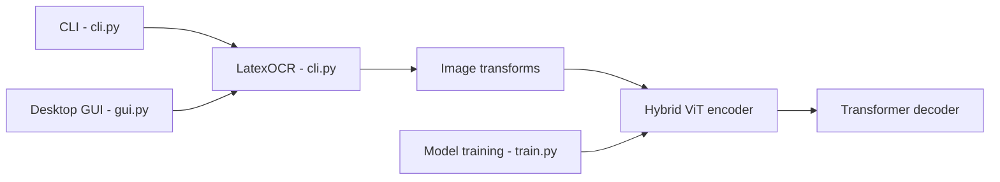

# lukas-blecher/LaTeX-OCR

> pix2tex model that converts an image of a mathematical formula into LaTeX code.

## The problem
Retyping by hand formulas seen in a PDF or a screenshot.

## What it actually does
A ResNet-based ViT encoder and a Transformer decoder produce the LaTeX. A second network predicts the optimal input resolution. Interfaces: `pix2tex` CLI, `latexocr` GUI with screen capture and MathJax rendering, Streamlit/Docker API, Python call. Reported scores: BLEU 0.88, normalized edit distance 0.10, token accuracy 0.60. Data generation via XeLaTeX.

## How it is wired


## Trying it
```bash
pip install "pix2tex[gui]"
pix2tex
latexocr
pip install -U "pix2tex[api]"
python -m pix2tex.api.run
```

## Cost and gotchas
Free; the weights download automatically. Last push in January 2025. Images that are too large do not work well; proofread the output.

## What it is not
Not 100% reliable (token accuracy of 0.60). Handwritten formulas are only half handled, and beam search is not implemented.

## Alternatives
No alternative named in the README.

## For you
Worth watching: handy for saving time on formulas, but average accuracy and a project with little activity.
