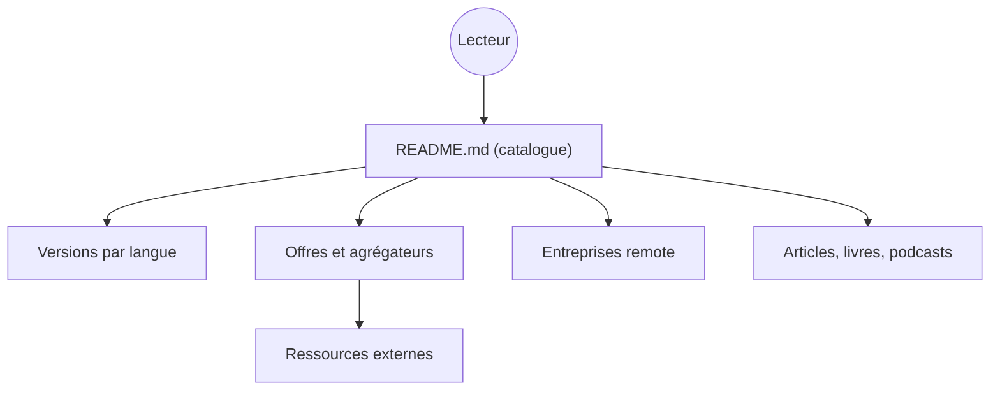

# lukasz-madon/awesome-remote-job

> List of remote work resources: job offers, companies, articles, tools, for anyone looking for a remote position.

## The problem
Job offers, advice and remote-friendly companies are scattered across the web.

## What it actually does
A multilingual README (English, Spanish, French, Chinese, Japanese) listing articles, videos, books, job sites, aggregators, coliving housing, relocation help, interview preparation, podcasts and "remote DNA" companies. No code: these are external links.

## How it is wired

## Trying it
No command documented: you read the list on GitHub, and contributions go through a pull request.

## Cost and gotchas
Free. Many links are aging (defunct companies, dated articles), and some entries are promotional. The README is cut off in the companies list: the rest was not read.

## What it is not
Not a job search engine: no offer is verified here. Not a legal or tax guide.

## Alternatives
No alternative named in the README.

## For you
Ignore: useful only for an occasional job search, and of no value for your tooling.
