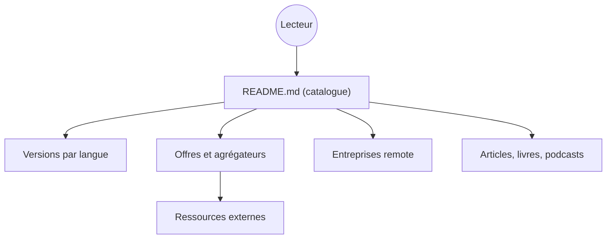

# lukasz-madon/awesome-remote-job

> Liste de ressources sur le travail à distance : offres, entreprises, articles, outils, pour qui cherche un poste remote.

## Le problème
Les offres, conseils et entreprises favorables au télétravail sont éparpillés sur le web.

## Ce que ça fait vraiment
Un README multilingue (anglais, espagnol, français, chinois, japonais) qui liste articles, vidéos, livres, sites d'offres, agrégateurs, logements de coliving, aides à la relocalisation, préparation d'entretiens, podcasts et entreprises « remote DNA ». Aucun code : ce sont des liens externes.

## Comment c'est branché

## Essayer
Aucune commande documentée : on lit la liste sur GitHub, les contributions passent par une pull request.

## Coût et pièges
Gratuit. Beaucoup de liens vieillissent (sociétés disparues, articles datés), et certaines entrées sont promotionnelles. Le README est coupé dans la liste des entreprises : la suite n'a pas été lue.

## Ce que ce n'est pas
Pas un moteur d'offres : aucune offre n'est vérifiée ici. Pas un guide juridique ni fiscal.

## Alternatives
Aucune alternative nommée dans le README.

## Pour toi
À ignorer : utile pour une recherche d'emploi ponctuelle seulement, et sans valeur pour ton outillage.

