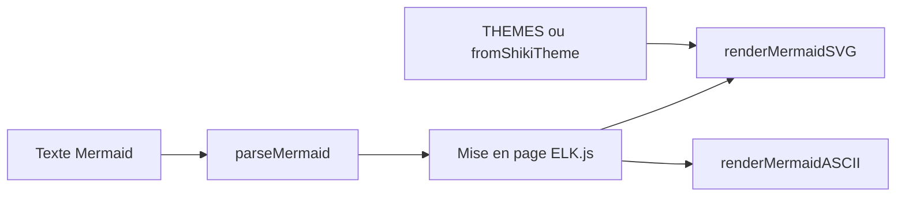

# lukilabs/beautiful-mermaid

> TypeScript library that turns Mermaid text into themeable SVG or ASCII art, for interfaces and terminals.

## The problem
Default Mermaid rendering is considered unpolished, hard to theme, without terminal output and heavy in dependencies.

## What it actually does
It renders six diagram types: flow, state, sequence, class, ER and XY charts. Output is SVG or ASCII and Unicode text. Rendering is synchronous, with no DOM. Colors come from two base values or from VS Code themes via Shiki, with 15 themes provided.

## How it is wired
Simplified diagram based on the sheet, no diagram provided.



## Trying it
```bash
npm install beautiful-mermaid
# ou
bun add beautiful-mermaid
# ou
pnpm add beautiful-mermaid
```

## Cost and gotchas
Free, MIT license. Young repository (January 2026) with 98 open issues. The diagram is tuned through render options, not a visual editor.

## What it is not
Not a diagram editor: it styles existing Mermaid. Supported diagram types are limited to the six listed.

## Alternatives
No alternative named, other than Mermaid itself whose default rendering is criticized.

## For you
Watch: handy for displaying diagrams in a terminal or an agent tool, without being central to a data or MLOps profile.
