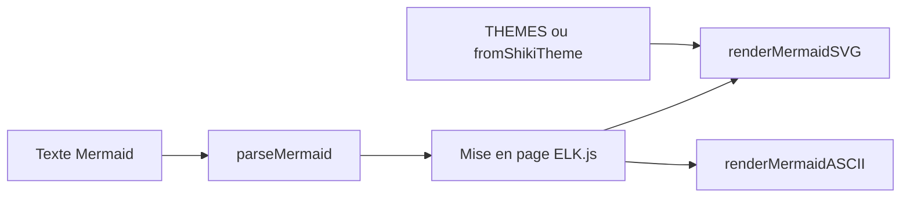

# lukilabs/beautiful-mermaid

> Bibliothèque TypeScript qui transforme du texte Mermaid en SVG thémable ou en art ASCII, pour interfaces et terminaux.

## Le problème
Le rendu Mermaid par défaut est jugé peu soigné, difficile à thémer, sans sortie terminal et lourd en dépendances.

## Ce que ça fait vraiment
Elle rend six types de diagrammes : flux, états, séquence, classes, ER et graphiques XY. La sortie est un SVG ou du texte ASCII et Unicode. Le rendu est synchrone, sans DOM. Les couleurs viennent de deux valeurs de base ou de thèmes VS Code via Shiki, avec 15 thèmes fournis.

## Comment c'est branché
Schéma simplifié d'après la fiche, sans diagramme fourni.



## Essayer
```bash
npm install beautiful-mermaid
# ou
bun add beautiful-mermaid
# ou
pnpm add beautiful-mermaid
```

## Coût et pièges
Gratuit, licence MIT. Dépôt jeune (janvier 2026) avec 98 issues ouvertes. Le diagramme se règle par options de rendu, pas par un éditeur visuel.

## Ce que ce n'est pas
Ce n'est pas un éditeur de diagrammes : il met en forme du Mermaid existant. Les types de diagrammes pris en charge sont limités aux six listés.

## Alternatives
Aucune alternative nommée, sinon Mermaid lui-même dont le rendu par défaut est critiqué.

## Pour toi
Surveiller : pratique pour afficher des schémas dans un terminal ou un outil d'agent, sans être central pour un profil data ou MLOps.

