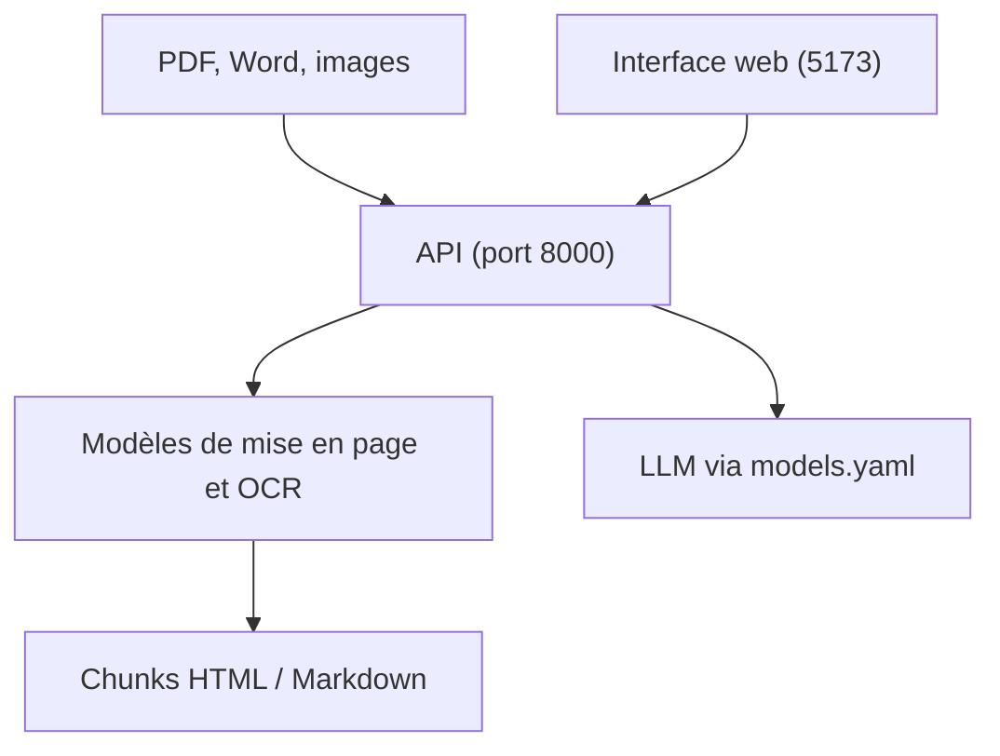

# lumina-ai-inc/chunkr

> API that splits PDF, Word and images into RAG-ready chunks, with OCR and layout analysis.

## The problem
Feeding a RAG with raw documents gives unstructured pieces: broken tables, lost reading order.

## What it actually does
The service analyzes the layout, performs OCR with coordinates, produces structured HTML and Markdown and processes pages with vision-language models. It installs through Docker Compose, with a web interface on port 5173 and an API on 8000. LLMs are configured in models.yaml or through environment variables, with any OpenAI-compatible endpoint. The free version uses open models; the cloud API uses proprietary models, which are more accurate.

## How it is wired
Simplified diagram based on the sheet, no diagram provided.


## Trying it
```bash
git clone https://github.com/lumina-ai-inc/chunkr
cd chunkr
cp .env.example .env
cp models.example.yaml models.yaml
docker compose up -d
docker compose -f compose.yaml -f compose.cpu.yaml up -d
```

## Cost and gotchas
Free on the code side, but an NVIDIA GPU is recommended (CPU mode possible). LLM calls are billed by your provider. Dual license: AGPL-3.0 or commercial license.

## What it is not
The free version does not match the cloud: open models, no Excel support. For use without the AGPL constraints, you must contact the vendor.

## Alternatives
Chunkr Cloud API (chunkr.ai): proprietary models, better accuracy, Excel supported.

## For you
Watch: a relevant building block for a document RAG pipeline, but the full quality is in the paid offering and the AGPL weighs on internal use as a service.
