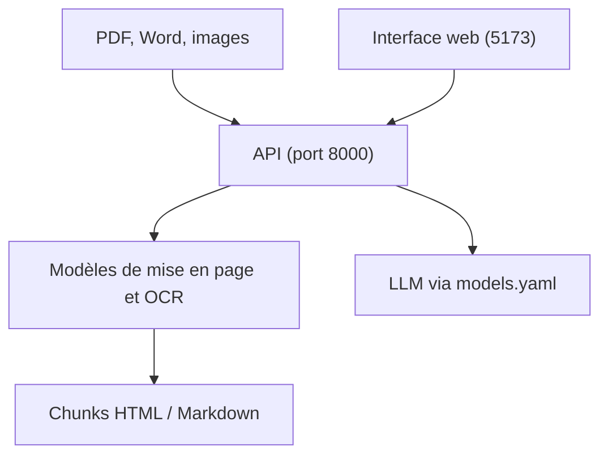

# lumina-ai-inc/chunkr

> API qui découpe PDF, Word et images en blocs prêts pour le RAG, avec OCR et mise en page.

## Le problème
Alimenter un RAG avec des documents bruts donne des morceaux sans structure : tableaux cassés, ordre de lecture perdu.

## Ce que ça fait vraiment
Le service analyse la mise en page, fait de l'OCR avec coordonnées, produit du HTML et du Markdown structurés et traite les pages avec des modèles vision-langage. Il s'installe par Docker Compose, avec une interface web sur le port 5173 et une API sur 8000. Les LLM se configurent dans models.yaml ou par variables d'environnement, avec tout point d'accès compatible OpenAI. La version libre emploie des modèles ouverts ; l'API cloud utilise des modèles propriétaires, plus précis.

## Comment c'est branché
Schéma simplifié d'après la fiche, sans diagramme fourni.


## Essayer
```bash
git clone https://github.com/lumina-ai-inc/chunkr
cd chunkr
cp .env.example .env
cp models.example.yaml models.yaml
docker compose up -d
docker compose -f compose.yaml -f compose.cpu.yaml up -d
```

## Coût et pièges
Gratuit côté code, mais le GPU NVIDIA est recommandé (mode CPU possible). Les appels LLM sont facturés par ton fournisseur. Licence double : AGPL-3.0 ou licence commerciale.

## Ce que ce n'est pas
La version libre n'égale pas le cloud : modèles ouverts, pas de prise en charge d'Excel. Pour une exploitation sans les contraintes AGPL, il faut contacter l'éditeur.

## Alternatives
Chunkr Cloud API (chunkr.ai) : modèles propriétaires, meilleure précision, Excel pris en charge.

## Pour toi
Surveiller : brique pertinente pour un pipeline RAG de documents, mais la qualité complète est dans l'offre payante et l'AGPL pèse sur un usage interne en service.

